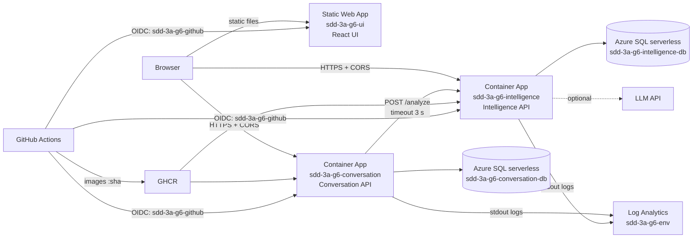

# Nebula Desk

A shared customer-support inbox where AI and human agents work together. Customer messages (simulated chat, email and WhatsApp) land in one inbox; the system classifies each one (intent, sentiment, priority) and suggests a reply; a human agent reviews, edits, assigns and resolves the conversation. A metrics page shows conversations by status, first-response time and the AI-suggestion acceptance rate.

**Live URL:** https://thankful-river-0e059a403.6.azurestaticapps.net/

## Architecture



| Part | Tech | Owns |
|---|---|---|
| `services/conversation-api` | Python 3.12, FastAPI, SQLAlchemy, Alembic | contacts, conversations, messages, agents (full CRUD), metrics |
| `services/intelligence-api` | Python 3.12, FastAPI, SQLAlchemy, Alembic | classification, suggested replies, analyses |
| `frontend` | React 18 + Vite, built to static files | UI |

Decisions: [`docs/decisions.md`](docs/decisions.md) · Data model: [`docs/data-model.md`](docs/data-model.md) · Monitoring and SLO: [`docs/monitoring.md`](docs/monitoring.md) · Migration evidence on Azure: [`docs/migration-evidence.md`](docs/migration-evidence.md) · Dashboard export: [`monitoring/workbook.json`](monitoring/workbook.json) · AI use: [`AI_USAGE.md`](AI_USAGE.md) · Scrum: [`docs/scrum/`](docs/scrum/)

## Run locally

Requirements: Docker Desktop (on Apple Silicon, enable **Use Rosetta for x86/amd64 emulation**).

```bash
git clone https://github.com/TheAleZap/nebula_desk.git
cd nebula_desk
docker compose up --build
```

- UI: http://localhost:5173
- Conversation API docs: http://localhost:8001/docs
- Intelligence API docs: http://localhost:8002/docs

Partial failure: `docker compose stop intelligence-api`. The inbox keeps working; "Analyze" shows **AI analysis is unavailable right now** after 3 seconds.

## Run the tests

```bash
cd services/conversation-api     # or services/intelligence-api
python -m venv .venv && source .venv/bin/activate   # Windows: .venv\Scripts\activate
pip install -r requirements-dev.txt
ruff check . && ruff format --check .
pytest                            # coverage report; fails below 70%
```

## Deployment

- **CI** (`.github/workflows/ci.yml`), every pull request and branch push: lint, format check, tests + coverage, UI build, image builds, full stack on SQL Server with a partial-failure check.
- **CD** (`.github/workflows/cd.yml`), every merge to `main`: CI → images tagged with the commit SHA to GHCR → both Container Apps updated (migrations run at start-up) → `/health` must return 200 with the new SHA → UI built with the service URLs and deployed to the Static Web App → smoke test.

### Reproduce the Azure setup (done once)

Azure Cloud Shell (Bash), directory **IE Instituto de Empresa**:

```bash
az login --tenant 5ca2bc70-353c-4d1f-b7d7-7f2b2259df68
gh auth login
git clone https://github.com/TheAleZap/nebula_desk.git && cd nebula_desk
export GH_REPO=TheAleZap/nebula_desk
bash infra/setup.sh
```

The script creates the SQL server, two serverless databases, one contained user per database, the Container Apps environment, two Container Apps (0–1 replicas), the Static Web App, the federated credential on `sdd-3a-g6-github`, and the GitHub secrets/variables. Passwords are generated and stored only as GitHub and Container Apps secrets.

The GHCR packages inherit the repository's public visibility, so Azure can pull them without credentials.

The script cannot give the pipeline identity its role, because Contributor cannot assign roles: a subscription owner must grant `sdd-3a-g6-github` the Contributor role on `rg-sdd-3a-g6` (for us this took from 19 to 24 Nov). Until then CD fails at "Azure login".

## Team

| Member | GitHub |
|---|---|
| Alejandro Zapata | @thealezap |
| Viktoriia Stepanenko | @viktoriiastepp |
| Alex Garcia | @agarcia246 |
| Alesia Dako | @dakoalesia1-boop |
| Kohana Rakipi | @krakipii |
| Elshan Ragimov | @eragimovieu |

Roles per sprint: see [`docs/scrum/`](docs/scrum/).
