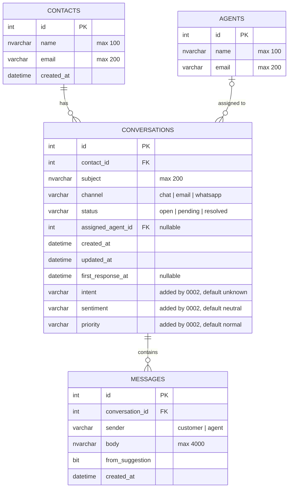
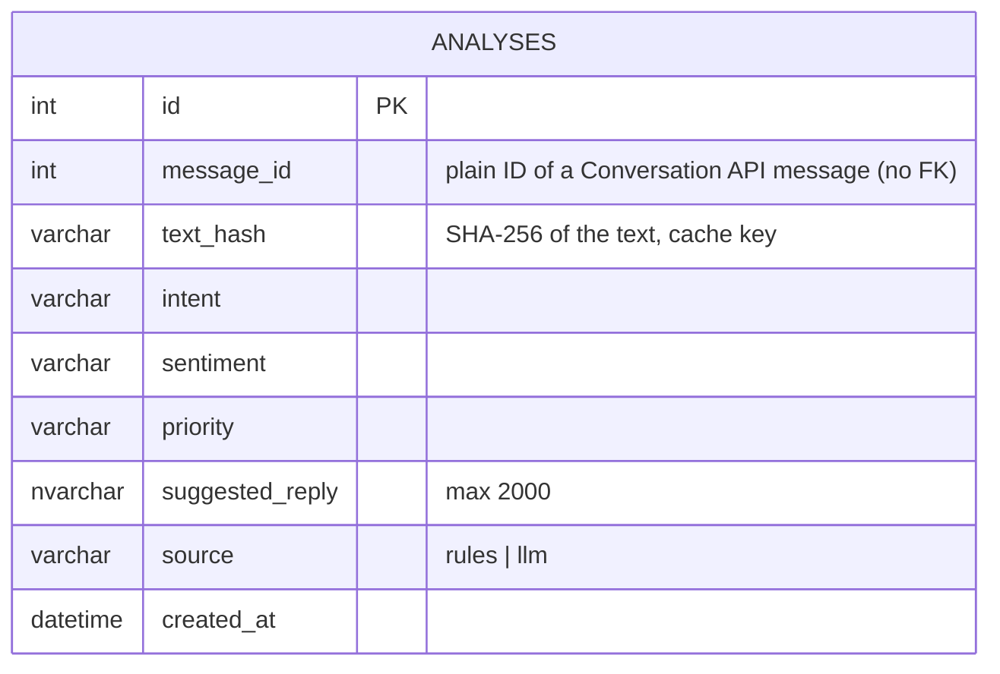

# Data Model

Nebula Desk uses **two separate SQL Server databases**, one per service, with no cross-database foreign keys:

1. **Conversation API database** (`sdd-3a-g6-conversation-db`), owned by `services/conversation-api`
2. **Intelligence API database** (`sdd-3a-g6-intelligence-db`), owned by `services/intelligence-api`

Alembic migrations live under `migrations/versions/` in each service and run automatically, once, at start-up; applied migrations are recorded in each database's `schema_migrations` table. Applied migrations are never modified; schema changes require a new revision.

**The seam.** `analyses.message_id` in the Intelligence database is a plain integer that refers to `messages.id` in the Conversation database. Integrity across the seam is deliberately not enforced: an analysis is a cache entry, so losing the link loses nothing important.

---

## Conversation API (`services/conversation-api`)

Defined by `0001_init.py` (all tables) and `0002_ai_labels.py` (the three AI label columns on `conversations`):

| Migration | Change |
|---|---|
| `0001_init` | Creates `agents`, `contacts`, `conversations` and `messages` |
| `0002_ai_labels` | Adds `intent`, `sentiment` and `priority` to `conversations`, each with a server default, so rows that already exist keep their data and get a value |

---

## Intelligence API (`services/intelligence-api`)

Defined by `0001_init.py`:

| Migration | Change |
|---|---|
| `0001_init` | Creates `analyses` with an index on `text_hash` |
