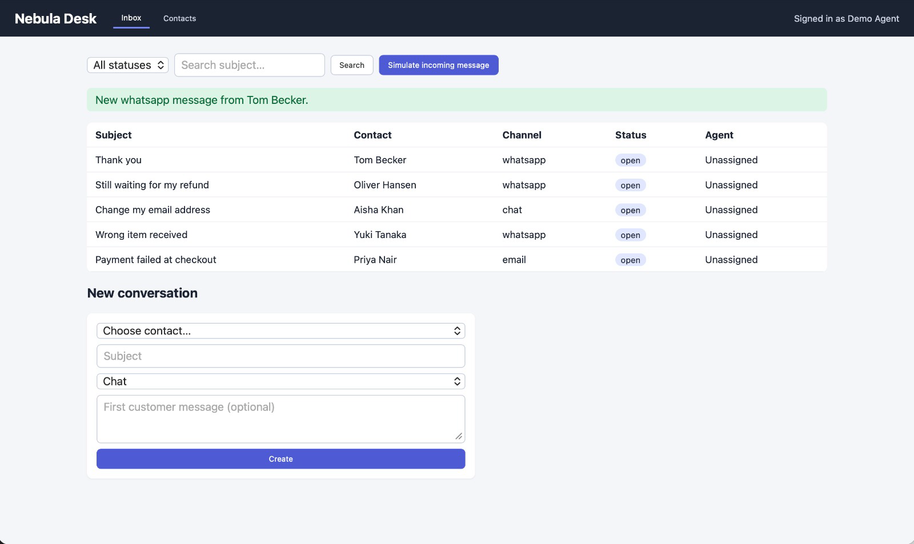
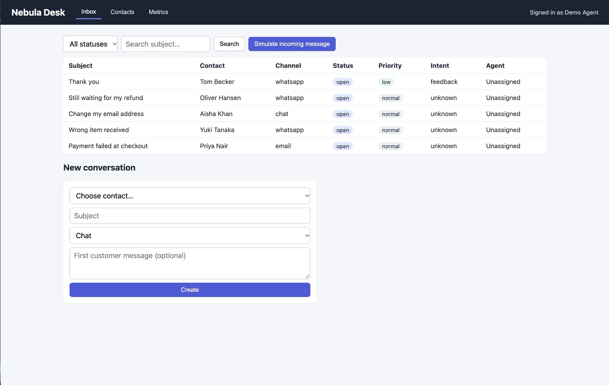

# Migration evidence: 0002 on Azure

Migration `0002_ai_labels` adds `intent`, `sentiment` and `priority` to `conversations` (each with a server default) on a database that already held data, without losing a row.

## Before: the deployed database holds data
Before PR #25 was deployed, the live version was the inbox without AI labels; we created 5 conversations on the live site with the "Simulate incoming message" button and took this screenshot on 24 Nov 2026 at 11:55 (Madrid time).



## The deployment
- CD run that deployed it: https://github.com/TheAleZap/nebula_desk/actions/runs/45381061389
- Start-up log line of the new revision (from `az containerapp logs show`):

```
{"TimeStamp": "2026-11-24T11:09:26.1676621+00:00", "Log": "F Running upgrade 0001 -> 0002, Add AI labels to conversations, keeping existing rows (defaults backfill them)."}
```

## After: same rows, new columns
After the deployment (screenshot at 12:23 Madrid time), the same 5 conversations are still there with the same subject, contact, channel and status, and they now show the new Priority and Intent columns, filled with the defaults (normal and unknown) or, for Tom Becker's conversation, with the analysed values (low and feedback).



## Why this is safe
The migration only adds columns with a server default, so SQL Server fills in a value for every existing row; nothing is dropped or recreated. Migrations run once at start-up and are recorded in `schema_migrations`, and the app runs with at most 1 replica, so the migration cannot run twice in parallel.